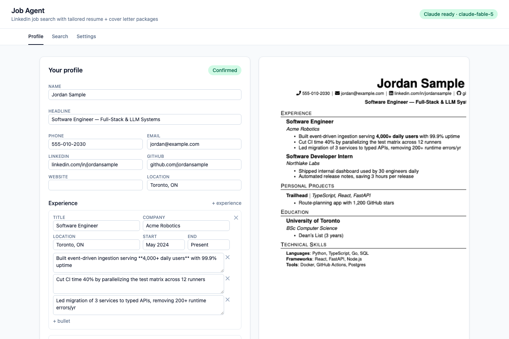
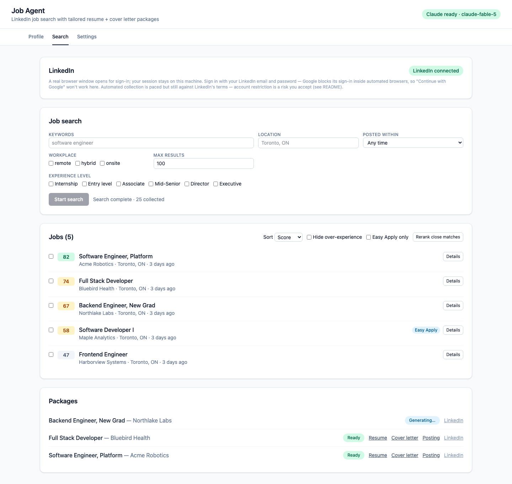
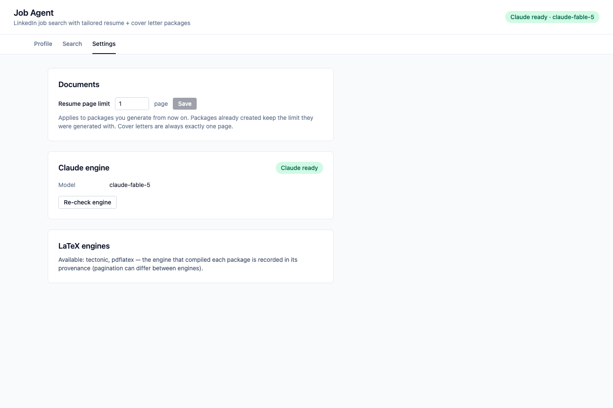
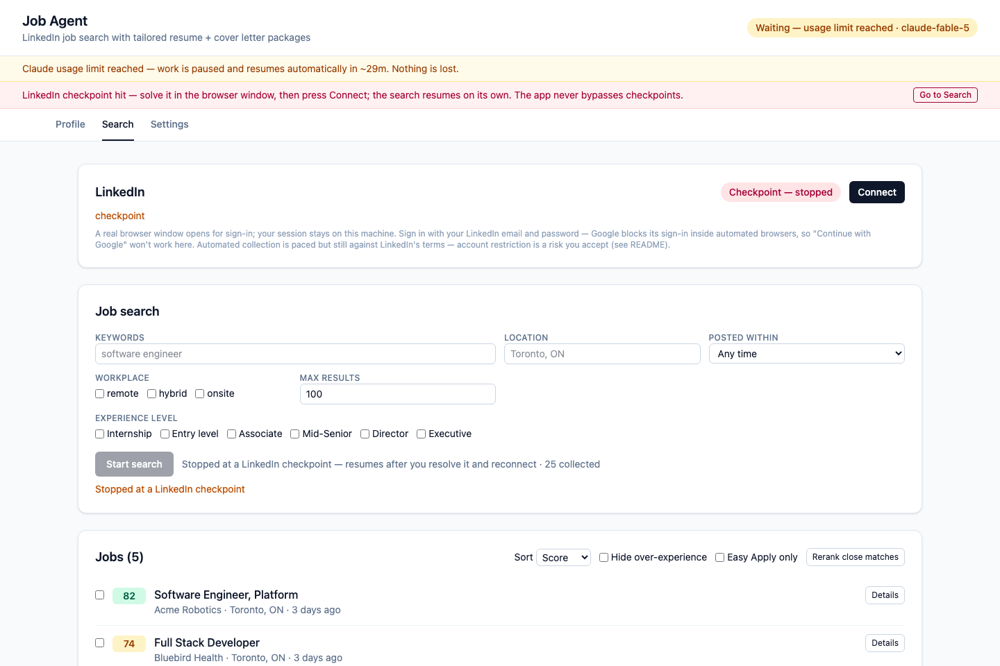

# Job Agent

A local web app that turns your resume + a LinkedIn job search into tailored,
LaTeX-typeset application packages — a resume and cover letter PDF per job,
with strict page-limit enforcement and no fabricated claims.

> **Status: v2 functional.** Resume ingestion, LinkedIn search, scoring,
> and package generation are complete and live-tested end to end
> (milestones M0–M4 in `PLAN.md`); polish (M5) is in progress.

## What it does

1. **Upload your resume** (PDF/DOCX). It's re-rendered into a clean,
   ATS-friendly LaTeX template that you confirm once — with unlimited inline
   corrections. (Your original layout is not preserved; the template is the
   point.) Scanned PDFs are handled by OCR fallback.
2. **Search LinkedIn** by keywords + location. You sign in once in a real
   browser window; the session persists locally.
3. **Browse scored jobs** in the UI — match score, experience filter,
   strengths/gaps — before anything is generated.
4. **Select the jobs you want.** For each one, the app autonomously writes a
   tailored resume and cover letter, validates every claim against facts
   extracted from *your* resume, enforces your page limit (default 1 page —
   never one line over), and drops finished PDFs in `output/`.

The app stops at PDFs. You click Apply yourself.

## Screenshots

*(All screenshots show sample data, not a real person or real LinkedIn
postings.)*

Confirm your extracted profile with a live LaTeX preview:



Scored jobs, selection, and generated packages:



Settings — the AI engine (one Claude or Codex model for every task), resume page
limit, appearance, LaTeX engines:



When something needs you, a banner says exactly what and why — the app
never sits silently and never asks for mid-run approvals:



## Quick start

macOS or Linux (Windows: use [WSL](https://learn.microsoft.com/windows/wsl/install)
and follow the Linux steps inside it).

```bash
git clone <this-repo> && cd job-agent
./scripts/setup.sh                                    # checks/installs everything, tells you what's missing
# If setup.sh had to install uv, this shell can't see it yet — open a new
# terminal, or: export PATH="$HOME/.local/bin:$PATH"
uv run python -m backend.core.claude_cli auth login   # sign in with your Claude subscription (first time only)
uv run job-agent                                      # → http://127.0.0.1:8700
```

Prefer a ChatGPT plan? Install the [Codex CLI](https://developers.openai.com/codex/cli),
sign in with `uv run python -m backend.core.codex_cli login`, and pick a Codex
model under **Settings → AI engine**. One sign-in is enough; with both you can
switch whenever one runs out of usage.

`setup.sh` needs internet access and will report exactly what's missing and
how to install it. The pieces:

| Dependency | Used for | Required? |
|---|---|---|
| [uv](https://docs.astral.sh/uv/) | Python environment | yes (auto-installed) |
| Node.js 22.18+ / npm | frontend build, unit tests | yes |
| [Tectonic](https://tectonic-typesetting.github.io) **0.17+** or pdflatex | PDF typesetting | for PDF generation |
| Tesseract + OCRmyPDF (+ Ghostscript) | scanned-resume OCR fallback | only for image-based PDFs |
| Playwright Chromium | LinkedIn browser | installed by setup when needed |
| [Codex CLI](https://developers.openai.com/codex/cli) | ChatGPT models (optional engine) | only to use Codex |

An installed LaTeX engine is not always a working one — Tectonic 0.16.x
aborts on this template's fonts. Setup test-compiles both real templates —
resume and cover letter — with every engine it finds, reads the text layer
back to confirm the PDF is machine-readable, and warns if none can produce
one. Re-check any time with:

```bash
uv run python -m backend.tailor.smoke_pdf
```

## Your subscription — Claude or Codex, no API keys

All AI work runs on **your own subscription**, never an API key and never
per-token billing. Two engines, and you pick one model for every task:

- **Claude** — through the Claude Agent SDK on your Claude plan (Pro/Max),
  signed in with `uv run python -m backend.core.claude_cli auth login`.
- **Codex** — through the Codex CLI on your ChatGPT plan, signed in with
  `uv run python -m backend.core.codex_cli login` (ChatGPT sign-in only;
  an OpenAI API key is refused). Optional: install the CLI only if you
  want these models.

Choose the model under **Settings → AI engine**: either provider's list, or
any model ID. The app never switches engines or models by itself.

- The default is Claude: `claude-fable-5`, falling back to `claude-opus-5`
  if your plan doesn't include Fable. A model you pick yourself never falls
  back — if your plan doesn't have it, the app says so and waits for you to
  pick another.
- Subscription usage limits apply, per provider (every model of that
  provider shares one limit). When a limit hits, queued work pauses and
  resumes on its own when the limit lifts — nothing is lost or regenerated.
  The engine picker opens once to show when it resets (when the provider
  says) and to let you switch to the other provider's model and keep going;
  it never opens over unsaved edits or an action still in flight — a banner
  carries the same way out.
- The model is locked down for this app: no file, shell, or web tools, and
  no open-ended agent loop — every call is a single prompt that must answer
  in JSON. For Codex, which is an agent with tools of its own, every
  tool-bearing feature is switched off (including the code and multi-agent
  modes newer Codex models ship with), and before a model is first used
  (and again whenever Codex or its model entry changes) the app checks the
  exact request Codex would send against a local stand-in: the chosen
  model, the app's instructions and your one prompt, nothing carried over
  from earlier, no tool beyond an inert question prompt, and a model that
  tries to call a tool is stopped at its first attempt. Nothing is sent
  upstream by that check. Every listed Codex model is checked when the
  model list loads; one that fails is shown as unavailable and can't be
  chosen, while the others stay usable.
- Each engine keeps its own sign-in inside the app — `.data/claude/` and
  `.data/codex/` — separate from any Claude Code or Codex install you may
  have, so the login commands above are needed once even if you already
  use those tools.

> **Note for redistributors:** Anthropic requires prior approval for
> third-party products that offer claude.ai sign-in (see the
> [Agent SDK terms](https://code.claude.com/docs/en/agent-sdk/overview)).
> Using this repo yourself on your own account is personal tooling; if you
> ship a product based on it, get that approval first, and check OpenAI's
> terms before offering ChatGPT sign-in.

## Privacy

- **Your resume content and job descriptions are sent to the engine you
  choose for processing: Claude (Anthropic) or Codex (OpenAI).** See
  [Anthropic's privacy policy](https://www.anthropic.com/legal/privacy) and
  [OpenAI's privacy policy](https://openai.com/policies/privacy-policy).
  Beyond that, the app's network traffic is LinkedIn itself (through your
  own signed-in browser session) and dependency downloads during setup;
  the bundled Claude CLI runs with telemetry and auto-update traffic
  disabled. The Codex CLI runs with web search off and only an allowlisted
  environment (no API keys or proxy settings from yours reach it); its own
  traffic goes to OpenAI.
- The server binds to `127.0.0.1` only — nothing is exposed to your network.
- All local state (your profile, jobs database, LinkedIn browser session)
  lives in `.data/`, created with owner-only permissions. Generated PDFs go
  to `output/`. Both are gitignored.

## LinkedIn: read this before using

**Automated access to LinkedIn violates LinkedIn's User Agreement.** This
app signs in as you and browses job search results the way a fast human
would — paced, capped, in a real browser — but pacing reduces load and
detection surface, **not** your terms-of-service exposure. Consequences,
including account restriction, are yours to accept. To keep risk as low as
practical, the app:

- uses your own logged-in session in one persistent real browser — no
  parallel scraping, no headless fleet, no API abuse;
- paces every action with human-like delays and daily caps;
- **stops cleanly the moment LinkedIn shows a captcha or checkpoint** and
  asks you to resolve it yourself in the browser window — it never attempts
  a bypass.

If that risk isn't acceptable to you, don't use the LinkedIn integration.
The job-source layer is a small interface, so other sources can be added.

**Sign in with your LinkedIn email and password.** Google refuses its own
sign-in inside automated browsers ("This browser or app may not be
secure"), so "Continue with Google" will not work in the window the app
opens — and the app will never try to disguise the browser to get around
that. If your LinkedIn account only has Google sign-in, set a password
first (LinkedIn Settings → Sign in & security).

## How tailoring stays honest

Every fact in your confirmed resume gets a stable source ID. Tailored
bullets and cover-letter paragraphs must cite the source facts they rely
on, and a validator checks that each cited fact actually supports the
claim — after generation *and* after every page-fitting rewrite. New
employers, degrees, dates, skills, or metrics that aren't in your resume
are rejected and repaired (up to two bounded repair rounds). A package
that can't pass validation or meet your page limit **fails** rather than
shipping something oversized or untrue.

## When something stops

Every stop state is autonomous-by-default and visible: a banner explains
what happened and the way out. Usage limit (either engine) → queued
scoring and package work pauses and resumes itself (never lost), and the
engine picker shows when the limit resets and lets you switch to the other
provider's model; one-off actions you trigger yourself (uploading a resume,
Explain, Re-rank) fail with a clear error instead — retry them after the
countdown or on the new model; sign-in expired → banner with the login
command (Settings has a re-check button); chosen model not on your plan →
banner, and work waits until you pick another; LinkedIn checkpoint → search stops
cleanly, you solve it in the browser window and press Connect — the
search then resumes on its own; LinkedIn session expired → reconnect
from the Search tab. Interrupted work — including a killed server
mid-generation — resumes from its last checkpoint: no completed,
checkpointed LLM call is ever repeated (only a call that was still in
flight at the moment of the kill runs again).

## Development

```bash
uv run job-agent                        # backend + built frontend on :8700
cd frontend && npm run dev              # optional: Vite dev server w/ HMR, proxies /api
uv run python -m backend.tests.smoke_llm  # live engine smoke test (uses your subscription)
```

Tests and checks:

```bash
uv run pytest                           # backend + browser tests (see below)
cd frontend && npm test                 # unit tests for the pure modules (node --test)
cd frontend && npm run lint             # oxlint
cd frontend && npm run check:contrast   # every colour-token pair against WCAG AA
cd frontend && npx tsc -b --noEmit      # type-check (strict, noUncheckedIndexedAccess)

# clean-Ubuntu fresh-clone test (setup -> frontend gates -> boot -> health
# -> Chromium launch -> full test suite with the browser tests required):
docker run --rm -v "$PWD":/src:ro -v "$PWD/scripts/ci":/scratch:ro \
  ubuntu:24.04 bash /scratch/ubuntu_freshclone.sh
# add -v "$HOME/ci-out":/out to keep its full test log and axe report
```

The Codex engine tests (`backend/tests/test_codex_engine.py`) run the real
Codex CLI against every model it lists, but only against localhost
stand-ins — nothing is sent upstream and no subscription is spent. They skip when Codex is not installed; set
`CODEX_TESTS_REQUIRED=1` to make that a failure instead.

The browser tests (`backend/tests/test_ui_*.py`) drive the built frontend
in Playwright's Chromium over synthetic API fixtures — no backend, no real
data. They need `frontend/dist` (`cd frontend && npm run build`) and the
Chromium that setup installs, and skip when either is missing. Set
`UI_TESTS_REQUIRED=1` to make that a failure instead, and to fail the run
if any browser test skipped or none ran; the Ubuntu script does. The
axe checks the tests could not decide are not failures; the run ends with
a summary of them by rule and reason, and `AXE_REPORT=<path>` writes every
one, with its state and selector, as JSON. `npm test` needs Node 22.18 or
newer, which strips TypeScript types itself; it does not type-check, `tsc`
does.

`PLAN.md` is the working spec. Architecture in short: FastAPI backend
(SQLite state, SSE progress), React + Vite + Tailwind frontend, Playwright
supervisor for LinkedIn, Tectonic/pdflatex for PDFs, and the Claude Agent
SDK or the Codex CLI — whichever you choose — for all reasoning.

## License

[MIT](LICENSE). Note the redistributor caveat above: shipping a product
that offers claude.ai sign-in needs Anthropic's approval (see the
[Agent SDK terms](https://code.claude.com/docs/en/agent-sdk/overview))
regardless of this code's license.
